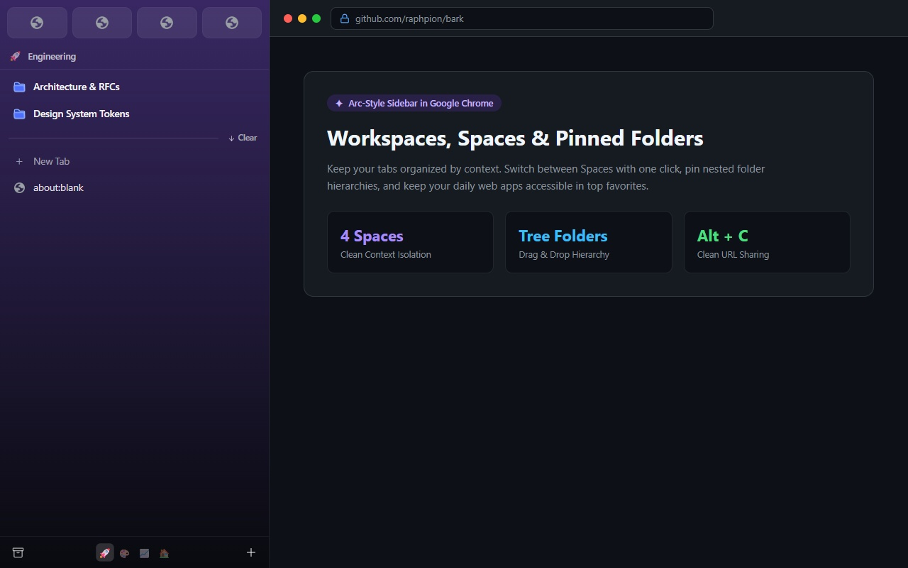
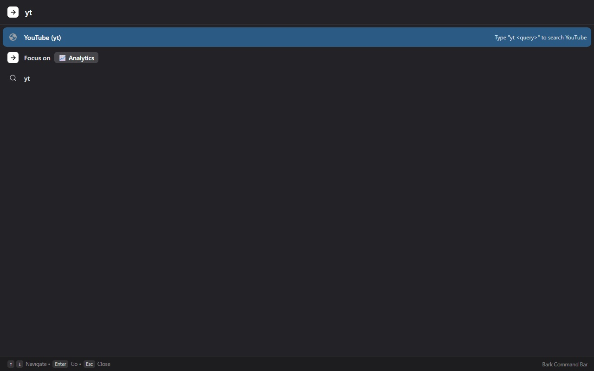
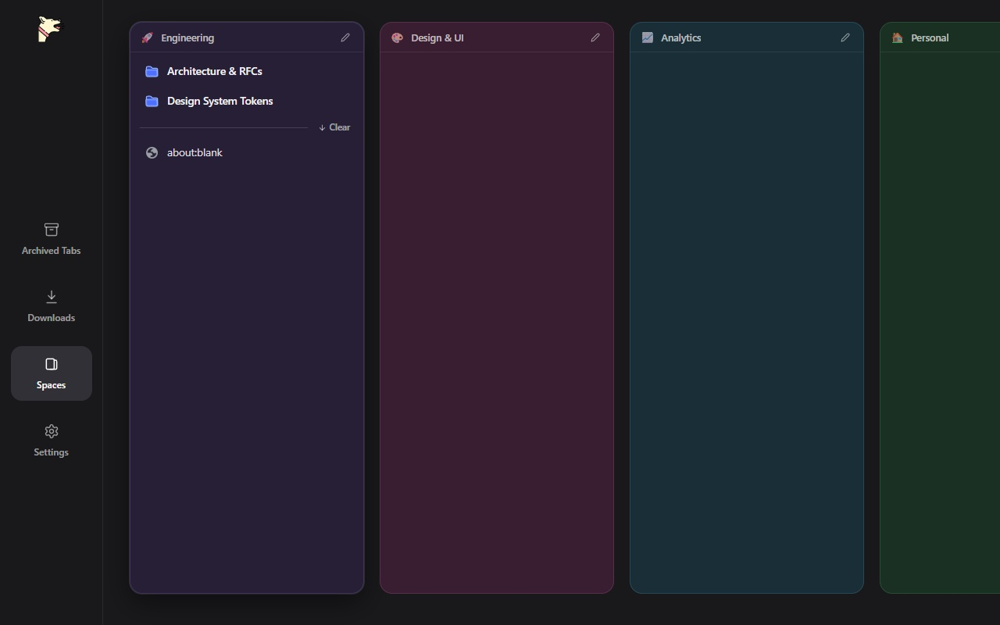
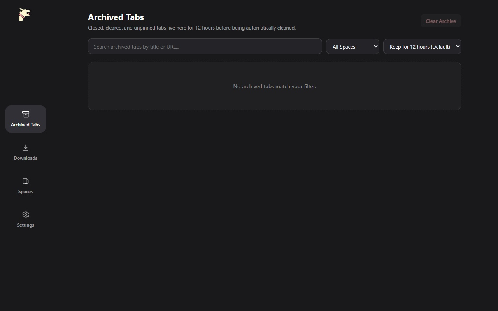
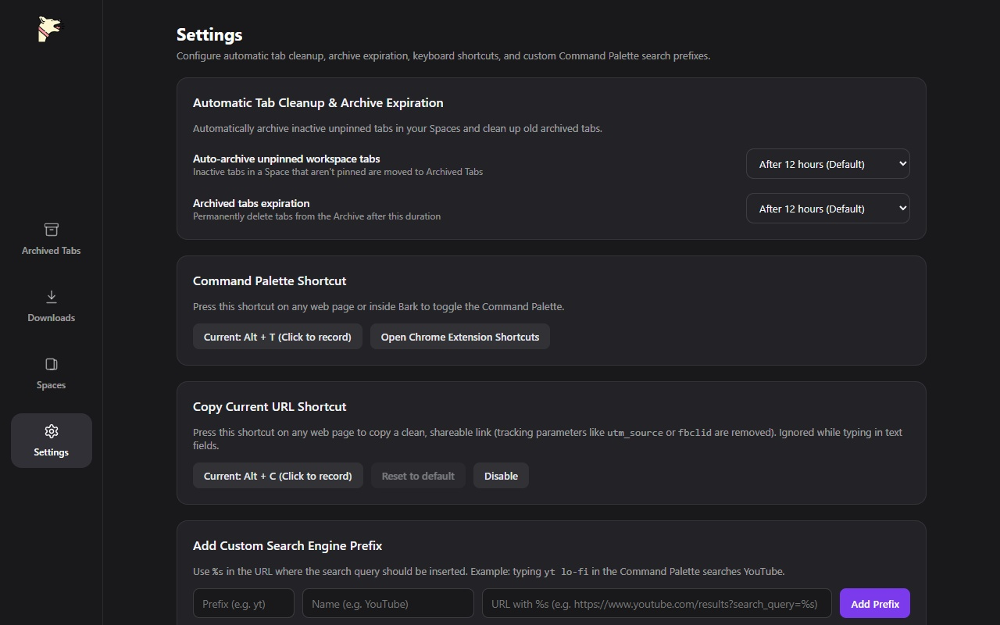

<p align="center">
  
</p>

<h1 align="center">Bark</h1>

<p align="center">
  <strong>Arc-inspired workspace manager, pinned tab folders, command palette, and archive hub for Google Chrome.</strong>
</p>

<p align="center">
  
</p>

## Features

- **Arc-Style Sidebar** (`chrome.sidePanel`):
  - **Spaces (Workspaces)**: Color-coded workspaces with emoji icons, synced two-way with Chrome Tab Groups.
  - **Global Favorites Grid**: Quick-access top-level bookmarks always available across all spaces.
  - **Pinned Tabs & Nested Folders**: Organize pinned tabs with drag-and-drop hierarchy, live navigation state detection, and a "Back to Pinned URL" button.
  - **Unpinned Tabs & Clean Up**: Auto-archive unpinned tabs on a customizable schedule, or clear them with one click.
  - **Copy Clean URL (<kbd>Alt</kbd>+<kbd>C</kbd> on Windows/Linux, <kbd>Ctrl</kbd>+<kbd>C</kbd> on macOS)**: Copy the current URL directly to clipboard stripped of tracking and analytics parameters (`utm_*`, `fbclid`, `gclid`, etc.).

- **Standalone Command Palette** (<kbd>Alt</kbd>+<kbd>T</kbd> on Windows/Linux, <kbd>Ctrl</kbd>+<kbd>T</kbd> on macOS):
  - Instant fuzzy search across open tabs, pinned tabs, and spaces.
  - Quick tab switching, space switching, and direct URL navigation.
  - Search engine shortcuts (e.g. `yt` for YouTube, `gh` for GitHub).

- **Bark Hub**:
  - **Spaces Board**: Visual grid of all workspaces with one-click focus and management.
  - **Archive Hub**: Chronological search and restore for closed or auto-archived tabs.
  - **Downloads**: Quick-access downloads tray within the extension.
  - **Settings**: Customizable auto-archive intervals, keyboard shortcuts, and custom search engines.

---

## Screenshots

| Workspaces & Sidebar | Command Palette |
| :---: | :---: |
|  |  |

| Spaces Board | Tab Archive |
| :---: | :---: |
|  |  |

| Settings & Search Shortcuts |
| :---: |
|  |

---

## Development

```bash
npm install
npm run check
npm test
npm run build
```

Load the `dist/` folder as an unpacked extension in `chrome://extensions/`.

For architecture details, security hardening rules, and engineering principles, see [AGENTS.md](./AGENTS.md).
